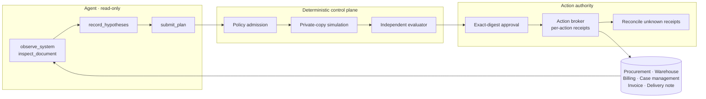

# RelayOps

**Evidence-grounded LangGraph agent that resolves cross-system operations exceptions, with counterfactual simulation, exact-version human approval and receipted, reconcilable execution.**

A short shipment touches four systems at once: the purchase order says 100 units, the warehouse received 80, billing was invoiced for 100, and a case is open. RelayOps gives a model read-only tools over those systems and their source documents, lets it record cited hypotheses and submit a typed plan, and then takes authority away from it. A deterministic policy recomputes the plan, a simulator executes it on a private copy, an independent evaluator checks the final state, an operator approves the exact plan digest, and an action broker applies each action once with a durable receipt. A lost acknowledgment is reconciled against observed state, never retried blindly.

Live app: https://relayops-two.vercel.app

## Architecture



| Component | Path | Responsibility |
| --- | --- | --- |
| Agent loop | `backend/src/relayops/agents/agent.py` | LangGraph `StateGraph` with conditional edges, tool dispatch, budgets, corrections and `AsyncSqliteSaver` checkpoints |
| Model transport | `backend/src/relayops/agents/agent_transport.py` | `AsyncAnthropic` typed SSE, token counting, cost reservation and model receipts |
| Browser evidence | `backend/src/relayops/agents/browser.py` | Playwright captures of source pages: PNG, SHA-256 and accessibility text |
| Policy | `backend/src/relayops/domain/policy.py` | Scope, source version, citation integrity, required outcome and exact action amounts |
| Simulation | `backend/src/relayops/agents/workflow.py` | Executes the plan on a private SQLite copy of the world |
| Evaluator | `backend/src/relayops/verification/evaluator.py` | Final-state checks kept outside the agent's tool surface |
| Action broker | `backend/src/relayops/execution/executor.py` | Approval, one action per transaction, receipts and reconciliation |
| Run store and workers | `backend/src/relayops/persistence/`, `workers/` | PostgreSQL queue with leases, heartbeats and owner-fenced publication |
| Product and imports | `backend/src/relayops/uploads/`, `product/` | CSV, TSV, XLSX, JSON and JSONL intake, SSE progress and HMAC-signed reports |
| Frontends | `frontend/apps/` | Product workspace, interactive demo, operator workbench and upload recording |

## How a case is resolved

1. **Observe.** The agent starts with only the tenant, case and source version. Each round it may call up to four evidence tools. `observe_system` returns one of four systems and `inspect_document` returns the invoice or delivery note, each with a content-addressed evidence ID.
2. **Hypothesize.** `record_hypotheses` stores up to three claims (supported, contradicted or uncertain). Every claim must cite evidence IDs observed in the same run.
3. **Propose.** `submit_plan` takes a strict, frozen Pydantic `Plan`: an outcome, an explanation, 4–12 evidence IDs and at most four typed actions.
4. **Admit.** `validate()` recomputes the shortage as ordered minus received. It requires `needs_information` when delivery is unconfirmed, the invoice disagrees with the order, or replacement stock cannot cover the shortage. It requires `no_change` when there is no shortage, and otherwise `resolve` with the exact action amounts. It refuses forged, duplicate, stale and cross-tenant citations. Policy errors go back to the model as bounded feedback, at most twice per run.
5. **Simulate.** The plan executes on a private copy. The evaluator then compares the original and final fixtures. A `resolve` plan gets 12 checks: scope and source preservation, the correct outcome, the held amount, claim and reservation quantities, the resolved status, no duplicate effects, and explicit review. A no-action plan gets 8, including that no business effect occurred.
6. **Approve.** The operator approves the SHA-256 digest of the exact plan. A change to the source or the plan invalidates that approval.
7. **Execute.** Each action runs in its own `BEGIN IMMEDIATE` transaction. Its receipt ID is `digest({plan, action index})`, so confirmed receipts are skipped on retry.
8. **Reconcile.** An action whose acknowledgment was lost keeps an `unknown` receipt, and execution refuses to continue past it. `reconcile()` confirms the receipt only when the observed billing and case state proves the effect, then the remaining actions run.

## Agent design

| Bound | Value | Enforced in |
| --- | --- | --- |
| Model rounds | 12 | `agent.py` |
| Output tokens | 2,048 per request, 12,000 per investigation | `agent.py` |
| Input tokens | 8,000 per request, 64,000 cumulative | `agent_transport.py` |
| Estimated spend | $0.50 cumulative, reserved before generation | `agent_transport.py` |
| Tool calls | 4 per round. `submit_plan` and `record_hypotheses` must be called alone. | `agent.py` |
| Evidence calls | 24 total, at most 3 identical | `agent.py` |
| Policy corrections | 2 | `agent.py` |
| Time | 240 s active model time, 60 s generation deadline, 30 s SDK timeout | `agent.py`, `agent_transport.py` |
| Request size | 2 MB provider body | `agent_transport.py` |
| Image context | 2 most recent screenshots. Older pixels are replaced with a placeholder, and their hash and text observation are retained. | `agent.py` |

- **Model receipts.** Every generation is recorded with its typed usage before the graph checkpoint commits. A completed matching receipt replays without a second call. An unknown or changed receipt blocks replay. Generation retries are zero, including after HTTP 429.
- **Crash recovery.** Graph state is checkpointed as plain JSON. A recovered run must match the source, runtime, dependency, client, pricing and browser fingerprints. Otherwise recovery is refused rather than migrated.
- **Live mode is opt-in.** It requires `RELAY_ALLOW_LIVE=1`, `ANTHROPIC_API_KEY`, and a `RELAY_MODEL` that matches the trusted pricing profile. Without these, the deterministic `ScriptedAgent` drives the same graph, tools and policy.

## Durable execution

Investigations are admitted into a PostgreSQL run store with idempotency keys, a 16-run active cap and request hashing. Separate workers claim runs with `FOR UPDATE SKIP LOCKED` and hold 60-second leases renewed every 10 seconds. Results are published only by the current lease owner. An expired lease marks the run interrupted and never requeues paid work. The API restarts independently of workers. CI runs this topology in Docker Compose and in a Kind cluster, restarting the API while a run stays queued.

## Results

Every number below comes from the required CI jobs. No live-model generation runs in CI.

| Check | Result |
| --- | --- |
| Unit and integration tests | 109 passing (3 require PostgreSQL and run against the CI service) |
| Scripted case matrix | 12 of 12 assessments correct across resolve, needs-information and no-change cases. Original business state untouched in all 12. |
| Interactive demo journey | Investigate, approve, lose an acknowledgment, reconcile, then verify 24 of 24 checks and 4 confirmed receipts |
| Operator workbench journey | 16 browser checks, including stale-proposal rejection, execution-before-review denial and duplicate-effect prevention |
| Product journey | 12 browser checks and 14 axe accessibility views |
| File imports | 8 browser checks across CSV, TSV, XLSX, JSON and JSONL |
| Containers and Kubernetes | Compose and Kind journeys with API restart, two workers, six browser observations and idempotent re-execution |

## Stack

Python 3.12 · LangGraph · Anthropic SDK · Pydantic · FastAPI · PostgreSQL 17 · SQLite · Playwright · Docker · Kubernetes (Kind) · Supabase (RLS) · Vercel

## Repository layout

```text
backend/src/relayops/
  agents/         LangGraph agent, model transport, browser evidence, planners
  domain/         fixture world, typed models, policy
  verification/   independent evaluator
  execution/      approval, executor, reconciliation
  persistence/    run store and migrations
  workers/        leased investigation workers
  uploads/        file imports, analysis, SSE streaming, report signing
  product/        product routes and optional accounts
  api/            FastAPI app, public sandbox, demo security
  evaluation/     scripted case matrix
backend/tests/    unit, integration and browser end-to-end tests
frontend/apps/    product, demo, workbench, uploads
infrastructure/   Compose, Kubernetes base and Kind overlay, Supabase migration
scripts/          repository, RLS and health checks; demo recorders; deployment smokes
docs/             architecture, product, operations, evaluation, development
```

## Run locally

```sh
git clone https://github.com/Akhilesh-Vangala/relayops.git
cd relayops
python3.12 -m venv .venv
.venv/bin/python -m pip install --require-hashes -r backend/requirements/runtime.txt
.venv/bin/python -m playwright install chromium
PYTHONPATH=backend/src RELAY_ALLOW_LIVE=0 .venv/bin/python -m relayops.api.web
```

The operator workbench opens at `http://127.0.0.1:8100`. To run the public build (product, interactive demo and uploads), set a signing secret of at least 48 characters:

```sh
RELAY_DEMO_SECRET=$(python3 -c "import secrets;print(secrets.token_urlsafe(48))") \
  .venv/bin/python -m uvicorn app:app --port 8000
```

## Testing

```sh
export PYTHONPATH=backend/src RELAY_ALLOW_LIVE=0
.venv/bin/python -m unittest discover -s backend/tests -v
.venv/bin/python -m relayops.evaluation.benchmark --output artifacts/generated/matrix
.venv/bin/python scripts/demos/public_demo_browser.py
.venv/bin/python backend/tests/e2e/browser_workbench.py
.venv/bin/python scripts/checks/check_repository.py
```

[Documentation](docs/README.md) · [Contributing](.github/CONTRIBUTING.md)
