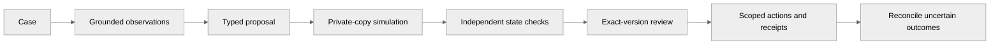
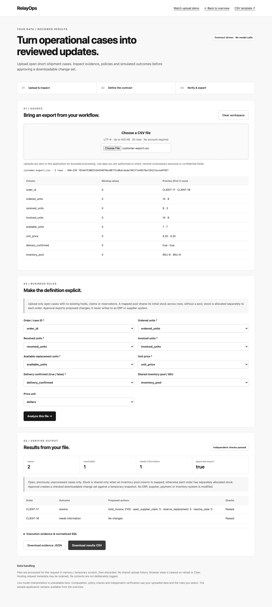

<p align="center"></p>

**Use your own data:** [Open the CSV workspace](https://relayops-two.vercel.app/uploads) · [Contracts, verification and data handling](docs/product/USER-DATA.md). Upload, map columns, review business rules, and download checked source-derived results. Public processing is contract-driven; live model interpretation remains unavailable.

<p align="center"><a href="https://github.com/Akhilesh-Vangala/relayops/actions/workflows/checks.yml"></a> &nbsp; Python · LangGraph · FastAPI · PostgreSQL</p>

# RelayOps

**Evidence to verified action.** A workflow agent with independent simulation, exact-version review and uncertain-action recovery.

[**Open the app ↗**](https://relayops-two.vercel.app/demo) · [**Watch the recording ↗**](https://relayops-two.vercel.app/demo/recording) · [Technical documentation](docs/README.md) · [Repository layout](docs/development/LAYOUT.md)

## The business problem

Resolve a supplier short shipment across procurement, warehouse, billing and case systems without paying an incorrect invoice or duplicating an uncertain action.

<a id="the-operator-workbench"></a>
<a id="see-the-workbench"></a>

## Run the workflow

<picture>
  <source media="(prefers-reduced-motion: reduce)" srcset="docs/assets/demos/relayops-interactive-poster.png">
  
</picture>

**Actual execution, guided synthetic data.** The continuous recording shows real browser interactions and server results. No live model call, customer data or user-validation claim. [Recording provenance and reproducible capture](docs/DEMO.md).

Four original synthetic cases. Investigate, inspect evidence and simulation, approve the exact proposal, execute isolated actions, inject a lost acknowledgment and reconcile it. Every action reconstructs a fresh fixture; signed review branches may be replayed until expiry.

<a id="inside-the-agent"></a>
<a id="the-agentic-workflow"></a>
<a id="a-real-dbt-repair-workflow"></a>
<a id="what-is-engineered-here"></a>

## Architecture and authority


A bounded LangGraph investigator observes original browser/document evidence, records cited hypotheses and submits typed proposals. Separate policy, private-copy simulation and final-state verification precede exact-version review and receipted actions. PostgreSQL coordinates leased browser workers; fixture worlds and checkpoints still use same-node files.



| Component | Owned responsibility |
| --- | --- |
| Frontend | Native monochrome browser UI, persistent detail URLs, evidence/review views, session history, exports and the recording player. |
| Backend | FastAPI routes, typed domain contracts, LangGraph orchestration, version/review gates and controlled synthetic execution. |
| Independent checking | Private-copy final-state evaluation and receipt/duplicate checks. |
| Persistent runtime | PostgreSQL queue and separate leased workers; same-node fixture/workspace artifacts remain an explicit boundary. |
| Public demo | Request-bounded synthetic execution with browser-session history. Live inference and persistent cloud workers are separate. |

## Repository layout

```text
relayops/
├── backend/
│   ├── src/relayops/
│   ├── tests/
│   ├── requirements/
│   ├── docker/
│   └── data/
├── frontend/
│   └── apps/
│       ├── demo/
│       │   └── assets/
│       │       ├── scripts/
│       │       ├── styles/
│       │       └── media/
│       └── workbench/
│           └── assets/
│               ├── scripts/
│               └── styles/
├── infrastructure/
│   ├── containers/
│   └── kubernetes/
├── scripts/
│   ├── checks/
│   ├── demos/
│   └── deployment/
├── docs/
│   ├── architecture/
│   ├── operations/
│   ├── evaluation/
│   ├── project/history/
│   └── assets/
│       ├── branding/
│       ├── diagrams/
│       ├── screenshots/
│       └── demos/
└── .github/
```

[Component ownership and commands](docs/development/LAYOUT.md) · [Current handoff](docs/project/HANDOFF.md) · [Release plan](docs/project/PLAN.md)

<a id="run-it"></a>

## Run locally

```sh
git clone https://github.com/Akhilesh-Vangala/relayops.git
cd relayops
python3.12 -m venv .venv
.venv/bin/python -m pip install --require-hashes -r backend/requirements/runtime.txt
.venv/bin/python -m playwright install chromium
PYTHONPATH=backend/src RELAY_ALLOW_LIVE=0 .venv/bin/python -m relayops.api.web
```

Open **http://127.0.0.1:8100**. The local workbench uses original synthetic data; guided/scripted checks need no provider key.

Python 3.11–3.12 is supported; CI and containers use 3.12. Keep private configuration in ignored `.env`; never overwrite an existing private configuration. [Full development and deployment guide](docs/operations/DEVELOPMENT.md).

<a id="verified-evidence"></a>
<a id="evidence-honestly-scoped"></a>

## Engineering evidence

| Scope | Evidence |
| --- | --- |
| Test coverage | 65 unit/integration cases; local PostgreSQL-only cases skip without its test database. Required CI supplies PostgreSQL and exercises real Compose/Kind worker recovery. |
| Known synthetic regression | 12 known scripted assessments; original business state stays untouched during investigation. |
| Actual browser | Investigation, evidence/SQL, verification, download, reload/history, mobile layout and the native recording player. |
| Live model quality | **Not evaluated.** Public demos force guided mode; native transport tests use controlled providers. |
| Customer production | **Not certified.** Monitored persistent cloud delivery, individual/tenant authority where applicable and actual-user feedback remain release gates. |

```sh
PYTHONPATH=backend/src RELAY_ALLOW_LIVE=0 python -m unittest discover -s backend/tests -v
PYTHONPATH=backend/src RELAY_ALLOW_LIVE=0 python backend/tests/e2e/browser_workbench.py
python scripts/demos/public_demo_browser.py
python scripts/checks/check_repository.py
```

Native commands run inside the project's installed environment. Required CI repeats the relevant checks on Linux. Test counts describe distinct cases; rerunning them in a container does not double the number of tests. [Evaluation and limits](docs/evaluation/README.md) · [Progress and source-linked evidence](docs/project/PROGRESS.md).

## Operating modes and limits

- **Guided public app:** real calculations over original synthetic fixtures; no paid generation. Signed anonymous review branches can be replayed/forked until expiry, so the public sandbox is not an immutable shared approval ledger or global exactly-once executor.
- **Private agent/runtime:** official Anthropic SDK, typed tools and bounded agent loops. A private provider key and explicit live selection are required; live quality and cost comparisons remain unmeasured.
- **Production boundary:** business-state/workspace files remain same-node; individual identity, per-run isolation, real connectors and monitored persistent cloud operation are open.

[Design decisions](docs/DECISIONS.md) · [Recorded demo](docs/DEMO.md) · [Branch policy](docs/development/BRANCHING.md) · [Contributing](.github/CONTRIBUTING.md) · [Dated history](docs/project/history/PRE-ORGANIZATION-README.md)

## Work with your own export

[Open the upload workspace](https://relayops-two.vercel.app/uploads) · [Watch the actual file-to-result recording](https://relayops-two.vercel.app/uploads/recording.html) · [Source-bound capture](docs/demos/uploads-recording.json).


