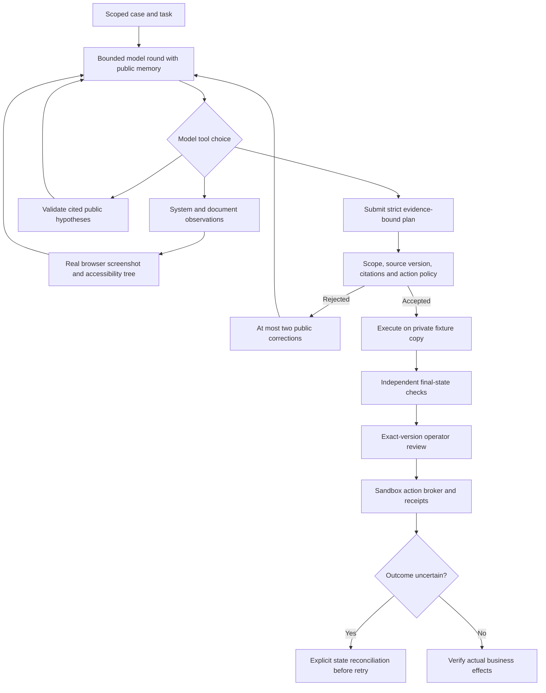

# RelayOps

**A model-directed enterprise workflow agent with browser evidence, cited memory, controlled actions and independent verification.**

RelayOps investigates operational exceptions across procurement, warehouse, billing and case-management evidence. The agent chooses read-only tools, inspects original document pages, records hypotheses, corrects rejected plans, and submits a proposal for counterfactual checking and exact-version operator review.

**Current development release:** a local monochrome workbench, real LangGraph tool loop/checkpoints, official Anthropic streaming client, real browser screenshots/accessibility observations, action receipts/reconciliation and execution-based tests. Live AI quality, real scanned-document extraction, arbitrary enterprise connectors, distributed infrastructure and cloud deployment remain unverified/pending. Scripted demonstrations are explicitly labeled.

## Open the workbench

```sh
PYTHONPATH=src .venv/bin/python -m relayops.web --port 8100
```

Open **http://127.0.0.1:8100**. Overview → case → investigation → evidence/hypotheses → proposal and verification → sandbox review → controlled execution. The default demonstration uses scripted model choices and makes no model calls. Live selection requires explicit private configuration and server-side admission. This is a local single-host research workbench; individual identity and public hosting are not implemented.

## The business problem

An order has100units at$25each, an invoice for100units and confirmed delivery of80units. Establish the20-unit shortage from source evidence; propose a$500hold,20-unit claim and20-unit replacement reservation; resolve only after effects are confirmed. Unknown delivery, inconsistent invoice quantity or insufficient stock requires no-write clarification; healthy delivery requires no change.

The current supported lane has a declared action contract. Broader planning and noisy real-world inputs require additional validated environments rather than assumed generalization.

## Implemented agent and execution layers



| Layer | Actual behavior |
| --- | --- |
| **Model-directed tool use** | Agent chooses `observe_system`, `inspect_document`, `record_hypotheses` or `submit_plan`. No fixed collection sequence in the live controller. |
| **Multimodal observations** | Playwright captures original local pages, screenshots and accessibility trees; image content is passed to the model. This is not yet real scanned-document extraction or general GUI navigation. |
| **Grounded public memory** | Hypotheses cite observed evidence; current interpretations and recent evidence IDs are included in model context. No hidden chain-of-thought is requested or displayed. |
| **Context management** | Only the latest two images stay in model context; original PNGs/hashes and textual observations remain stored. Byte/token bounds apply before generation. |
| **Critique and correction** | Strict schema, evidence coverage, source and business-policy feedback permit two corrections; private evaluator answers never enter feedback. |
| **Persistent investigation** | SQLite LangGraph checkpoints plus model-result receipts; recovery requires identical source/runtime/client/pricing/browser configuration. Uncertain generations block replay. |
| **Independent checking** | Private-copy simulation, separate final-state evaluator and unchanged-source/duplicate-effect checks. These are scoped checks, not universal proof. |
| **Review and action control** | Immutable exact-version sandbox review; stale/tampered/source-changed assessments blocked. Controlled actions retain receipts, uncertain outcomes and partial state. |
| **Operator visibility** | Home, cases, investigation history/detail, evidence screenshots, hypothesis memory, real activity, proposed changes, verification and architecture pages. |

## Bounds and spending

The current agent allows12model rounds,24evidence calls,3identical calls,2public corrections,2048requested output tokens per round/12000total,8000counted input per request/64000cumulative,240active model seconds and a2MBmultimodal body. Typed streaming must include completion; real generation retries are disabled.

Agent receipts enforce a **$0.50 cumulative estimated commitment allowance per run**, retain unknown reservations, and account for reported usage overruns before allowing more generations. This is not a provider invoice cap or shared cross-run billing system. A private key, RELAY_ALLOW_LIVE=1 and RELAY_MODEL matching the trusted pricing profile are required. No live generation has been performed in the recorded milestone.

## Reproduce

Python3.11.17 is used locally. Fresh environment:

```sh
python3.11 -m venv .venv
.venv/bin/python -m pip install --require-hashes -r requirements.txt
.venv/bin/python -m playwright install chromium
PYTHONPATH=src .venv/bin/python -m unittest discover -s tests -v
PYTHONPATH=src .venv/bin/python tests/browser_workbench.py
PYTHONPATH=src .venv/bin/python -m relayops.agent_cli --output artifacts/generated/browser-demo --browser --test-correction
PYTHONPATH=src .venv/bin/python -m relayops.benchmark --output artifacts/generated/development-matrix
```

Use fresh output directories. `agent_cli --recover` explicitly resumes a compatible saved run; no automatic paid recovery. Legacy `python -m relayops` retains the original deterministic/single-request assessment and controlled sandbox execution examples.

For a privately configured live run, choose `--client anthropic` in agent_cli. Configuration uses exported values; the project never loads another project's private.env. Observe costs and failures on a bounded live smoke before broader evaluation.

## Recorded evidence

**47unit/integration tests,16real browser journey checks and12/12known scripted development assessments pass.** Tests include actual official SDK HTTP/SSE assembly over a mock transport, rate-limit/no-retry behavior, truncated streams, completed receipt reuse, checkpoint recovery, forged evidence/tools, browser observation hashes, review integrity, changed-source rejection and duplicate prevention.

The browser journey captures six actual source screenshots, checks five pages at320/390/768/1440px, verifies grounded clarification and tests explicit review/execution. Private/temp approvals are synthetic test actions, not customer feedback. These are engineering/integration results, **not live model accuracy or unseen generalization**. Generated artifacts remain ignored.

## Architecture and next gates

Implemented: Python, LangGraph, Pydantic, AsyncAnthropic, Playwright, FastAPI/Uvicorn and local SQLite. LangSmith is a transitive dependency, not an implemented integration. No embeddings/vector retrieval is claimed.

Next gates: early live model comparison; OCR/VLM extraction with field provenance on noisy documents; general browser/API action adapters; more workflow contracts and frozen held-out tasks; PostgreSQL/Temporal; individual identity, execution isolation and concurrency/recovery tests; production frontend and monitored cloud deployment; actual user feedback. Learned policy/training is conditional on measured failure modes and validated trajectories.

- [Implemented agent/workbench details](docs/09-AGENT-AND-WORKBENCH.md)
- [Brief](docs/01-PROJECT-BRIEF.md) · [Architecture](docs/02-ARCHITECTURE.md) · [AI design](docs/05-AI-DESIGN.md)
- [Data](docs/04-DATA-AND-INTEGRATIONS.md) · [Flow](docs/03-PROJECT-FLOW.md) · [Evaluation](docs/06-EVALUATION.md)
- [Setup](docs/07-SETUP-AND-DEPLOYMENT.md) · [Demo](docs/08-PORTFOLIO-AND-DEMO.md)
- [Plan](PLAN.md) · [Progress](PROGRESS.md) · [Handoff](HANDOFF.md) · [Decisions](docs/DECISIONS.md)
- [Preserved foundation README](README-HISTORY.md)

GitHub repository: TBD. No remote publication or cloud deployment is claimed.
