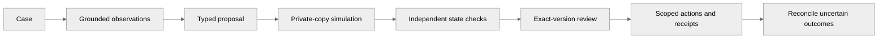

<p align="center"></p>

**Evidence to verified action.** [Open RelayOps](https://relayops-two.vercel.app/) · [Upload your data](https://relayops-two.vercel.app/uploads) · [Docs](docs/README.md)

<p align="center"><a href="https://github.com/Akhilesh-Vangala/relayops/actions/workflows/checks.yml"></a> &nbsp; Python · LangGraph · FastAPI · PostgreSQL</p>

# RelayOps

A workflow agent with independent simulation, exact-version review, and uncertain-action recovery — so a short-shipment case across procurement, warehouse, billing, and case systems does not pay the wrong invoice or duplicate an action.

[**Open the app ↗**](https://relayops-two.vercel.app/) · [Technical documentation](docs/README.md) · [Repository layout](docs/development/LAYOUT.md)

## Architecture




| Component | Responsibility |
| --- | --- |
| Frontend | Operator workbench, evidence/review views, session history, exports |
| Backend | FastAPI, typed contracts, LangGraph orchestration, review gates |
| Independent checking | Private-copy final-state evaluation and receipt/duplicate checks |
| Runtime | PostgreSQL queue and leased workers; fixtures remain same-node |

## Repository layout

```text
relayops/
├── backend/          src, tests, requirements, docker, data
├── frontend/         demo + workbench apps
├── infrastructure/   containers, kubernetes
├── scripts/          checks, demos, deployment
├── docs/
└── .github/
```

## Run locally

```sh
git clone https://github.com/Akhilesh-Vangala/relayops.git
cd relayops
python3.12 -m venv .venv
.venv/bin/python -m pip install --require-hashes -r backend/requirements/runtime.txt
.venv/bin/python -m playwright install chromium
PYTHONPATH=backend/src RELAY_ALLOW_LIVE=0 .venv/bin/python -m relayops.api.web
```

Open **http://127.0.0.1:8100**. [Full development guide](docs/operations/DEVELOPMENT.md).

## Checks

```sh
PYTHONPATH=backend/src RELAY_ALLOW_LIVE=0 python -m unittest discover -s backend/tests -v
python scripts/checks/check_repository.py
```

Public demos use guided synthetic fixtures (no live inference claim). Live model quality and customer production certification remain out of scope. [Evaluation](docs/evaluation/README.md) · [Demo notes](docs/DEMO.md)
