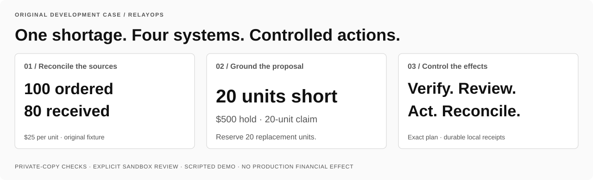
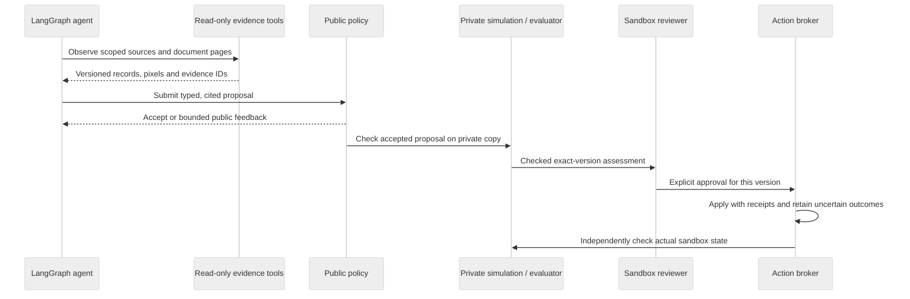

# RelayOps / engineering case study

**An operational proposal needs evidence, verification, explicit authority and a recoverable record of its effects.**

[Recorded demo](DEMO.md) · [System map](assets/relayops-architecture.svg) · [Source and tradeoffs](10-REPOSITORY-GUIDE.md) · [Run it](../README.md#run-locally)

## The original business case

An order for 100 units at $25 per unit has an invoice for 100 and confirmed receipt of 80. A consistent case with sufficient stock permits a $500 hold, a 20-unit supplier claim and a 20-unit replacement reservation before resolution. Missing authoritative receipt, inconsistent billing or insufficient stock requires clarification without business writes. Complete delivery requires no change.

The current environment and documents are original synthetic fixtures. The policy declares one supported workflow; there is no claim of arbitrary business planning or deployed financial operations.

## What is technically difficult

A plausible explanation does not establish that source facts are current, that the operator authorized this version, or that a timed-out action failed. An investigation must keep those questions separate. A retry after an uncertain write can produce duplicate effects; a changed source can make an approved plan stale.

| Responsibility | Owned implementation | Why it matters |
| --- | --- | --- |
| Choose and ground evidence | [agent.py](../src/relayops/agent.py), [browser.py](../src/relayops/browser.py) | Conditional model/tool loop; cited hypotheses, source versions, actual PNG/accessibility observations and bounded corrections. |
| Bound model execution | [agent_transport.py](../src/relayops/agent_transport.py) | Official async SDK streaming plus application-owned request receipts, budgets and unresolved-call replay blocking. |
| Admit a proposal | [domain.py](../src/relayops/domain.py), [policy.py](../src/relayops/policy.py) | Strict plan structure, scope/source/citation checks and exact declared action quantities/order. |
| Check effects before review | [workflow.py](../src/relayops/workflow.py), [evaluator.py](../src/relayops/evaluator.py) | Private-copy execution and separate final-state checks outside model authority. |
| Authorize and execute | [web.py](../src/relayops/web.py), [executor.py](../src/relayops/executor.py) | Exact-version immutable sandbox review, per-action receipts and explicit unknown-outcome reconciliation. |

## Authority boundaries

The diagram describes the supported workflow. The model does not approve actions or read private evaluator answers. External service semantics require new adapters and validation; the current effects and receipts share a local fixture backend.

## Failure behavior worth inspecting

| Failure | Expected behavior | Evidence |
| --- | --- | --- |
| Incorrect proposed amount | Public validation rejects the proposal; the scripted demo exercises one correction. | [Recorded walkthrough](DEMO.md), [agent tests](../tests/test_agent.py) |
| Missing authoritative delivery | Grounded clarification and no business actions. | [Known matrix](../src/relayops/benchmark.py), [browser journey](../tests/browser_workbench.py) |
| Truncated stream or uncertain generation | Preserve unknown commitment; block blind generation replay. | [Actual SDK mock-HTTP/SSE tests](../tests/test_agent_transport.py) |
| Stale or tampered report/source | Reject review/execution admission. | [Web integrity tests](../tests/test_web.py) |
| Lost action acknowledgement | Retain the uncertain receipt; explicitly reconcile before continuation. | [Execution/recovery tests](../tests/test_execution.py) |
| Repeated approved execution | Reuse confirmed receipts; verify no duplicate effects. | [Recorded sandbox execution](DEMO.md), [execution tests](../tests/test_execution.py) |

## What the evidence establishes

The recorded implementation has 47 unit/integration tests, 16 actual browser journey checks and 12 known scripted development assessments. The [published evidence](11-GITHUB-PUBLICATION.md) identifies an actual CI baseline; the README badge tracks the current branch. [Contributing](../CONTRIBUTING.md) reproduces the checks.

The recording shows actual local app execution, six browser captures, five graph rounds, one public correction, private-copy checking, synthetic review and verified sandbox effects. These establish integration behavior. Live model/VLM quality, held-out generalization, scanned-PDF extraction, customer benefit and cloud operation remain pending.

## Design choices and current limits

- **Separate proposal from authority.** The agent has read-only observation and proposal tools; approval and effect execution remain outside its tool surface.
- **Retain uncertainty.** Completed matching model receipts avoid a second generation; unknown generations and action outcomes block blind replay.
- **Preserve provenance.** Source/runtime compatibility, cited records and PNG hashes make the current evidence inspectable. Hashes are integrity checks, not administrator-proof storage.
- **Bound context.** Recent-image policy and request budgets constrain payloads; this does not establish long-horizon model quality.
- **Declare scope.** Structured source fields accompany screenshots, and policy enforces one fixed business contract. Current results do not isolate document perception or prove open-ended planning.
- **Use local infrastructure honestly.** SQLite, API-local background tasks and browser contexts remain single-host development choices. Individual identity, durable distributed lifecycle, per-task isolation and external business connectors are release gates.

The next useful experiment is a matched live comparison plus document-required tasks and one separate sandbox action service. PostgreSQL/Temporal/identity/cloud work must preserve the existing authority and uncertainty boundaries. See [release plan](../PLAN.md) and [current implementation](09-AGENT-AND-WORKBENCH.md).
