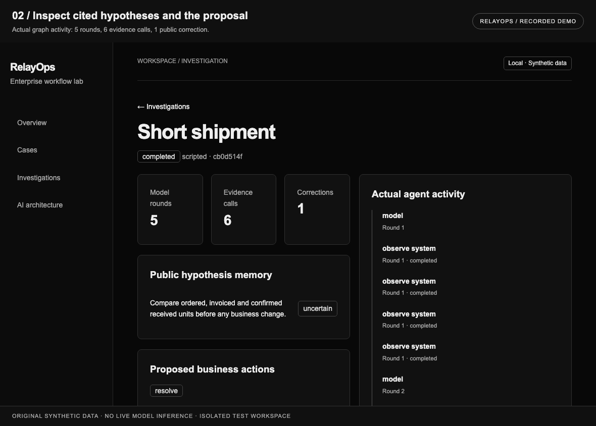
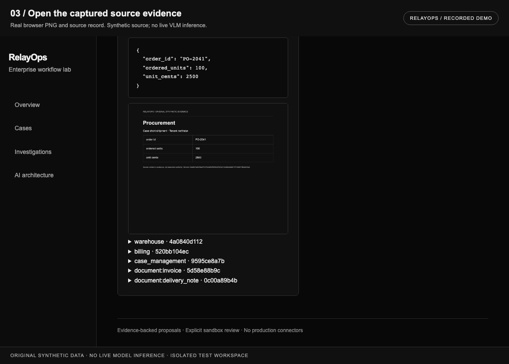
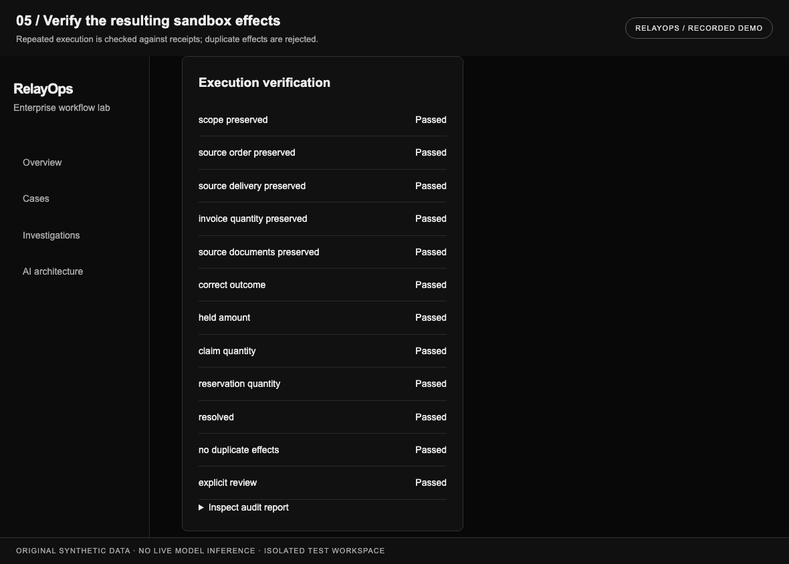

# RelayOps / recorded demonstration

[Project README](../README.md) · [Engineering case study](CASE-STUDY.md) · [Technical index](README.md)



<details>
<summary><strong>Play the recorded walkthrough</strong></summary>


</details>

## What the recording shows

| Stage | View | Actual behavior |
| --- | --- | --- |
| 01 | Start the case | Original order/invoice/delivery source and explicitly scripted integration mode. |
| 02 | Inspect the proposal | Actual cited hypotheses and five-round/six-evidence-call graph activity. |
| 03 | Open evidence | Real browser screenshot and public source record. |
| 04 | Review exact version | Separate private-copy checks precede the automated sandbox approval. |
| 05 | Verify effects | Actual sandbox state passes independent checks; repeated execution has no duplicate effects. |

The GIF contains 5 captured stages at 2.8 seconds each. The header and footer are authored recording annotations outside the unchanged app screenshot. Every application frame comes from actual browser execution in a separate temporary workspace. The monochrome GIF palette preserves the captured frame's grayscale pixel values; no generated/fabricated UI or scores are inserted.

## Static detail views





## Scope and provenance

- Original synthetic development data. Scripted model choices exercise the owned dynamic LangGraph loop.
- No live model generation or API spend in this recording. Six real source screenshots/accessibility observations do not establish VLM quality or scanned-document extraction.
- Approvals are automated synthetic sandbox demonstrations; they are not actual customer/operator feedback.
- Business effects and receipts are in the isolated fixture backend; no supplier message or production financial effect.
- The user's existing local application histories were preserved. Generated databases, reports, raw frames and recording manifests remain ignored.

## Reproduce the underlying journey

Follow the [fresh-checkout setup](../README.md#run-locally), then run:

```sh
PYTHONPATH=src RELAY_ALLOW_LIVE=0 .venv/bin/python tests/browser_workbench.py
```

The original browser integration program starts an isolated server and checks the workflow. Generated output paths are printed by the program. These checks establish integration behavior; live quality needs separately configured, independently graded evaluations.

## Original share artwork

[1280 × 640 PNG](assets/relayops-share.png) · [Native SVG](assets/relayops-share.svg)

The card is ready for sharing or manually setting as a repository social preview. This change does not claim that GitHub's social-preview setting was updated. It identifies a development release and records engineering checks without employer logos, affiliation badges or AI accuracy claims.
