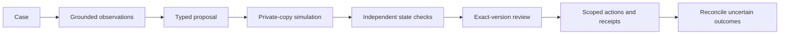

# End-to-end flow

Four original synthetic cases. Investigate, inspect evidence and simulation, approve the exact proposal, execute isolated actions, inject a lost acknowledgment and reconcile it. Every action reconstructs a fresh fixture; signed review branches may be replayed until expiry.

Private agent/runtime:

[Frontend/backend ownership](../development/LAYOUT.md) · [Agent behavior](AGENT-WORKBENCH.md) · [Public per-request replay boundary](../operations/PUBLIC-SANDBOX.md) · [Original flow history](../project/history/FOUNDATION-FLOW.md).
