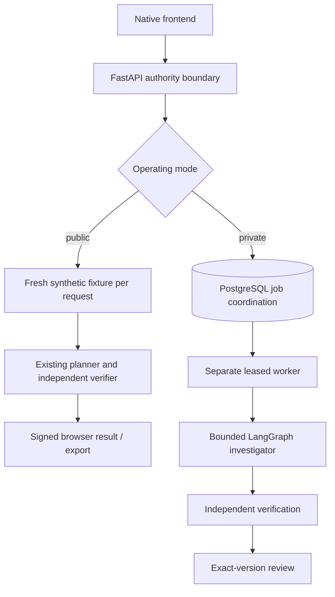

# RelayOps architecture

## Implemented private runtime

A bounded LangGraph investigator observes original browser/document evidence, records cited hypotheses and submits typed proposals. Separate policy, private-copy simulation and final-state verification precede exact-version review and receipted actions. PostgreSQL coordinates leased browser workers; fixture worlds and checkpoints still use same-node files.

## Implemented public sandbox

Four original synthetic cases. Investigate, inspect evidence and simulation, approve the exact proposal, execute isolated actions, inject a lost acknowledgment and reconcile it. Every action reconstructs a fresh fixture; signed review branches may be replayed until expiry.

Public state is browser-local and signed where review/action scope requires it. Request stages rebuild original fixtures, not durable business effects. The private persistent worker, live SDK controller and broader browser/dbt integration are separate operating paths.

The model cannot approve its own proposal or bypass typed scope, SQL/action policy or independent verification. Durable business-state/workspace files remain same-node; individual identity, real connectors, per-run isolation and monitored cloud operation are release work. Temporal and a general browser-action agent are proposals, not installed components.

[Agent details](AGENT-WORKBENCH.md) · [Current layout](../development/LAYOUT.md) · [Original foundation architecture](../project/history/FOUNDATION-OVERVIEW.md).
