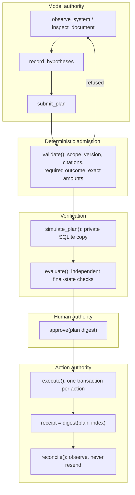

# Architecture overview

RelayOps separates four kinds of authority that are usually merged in agent systems: observing sources, proposing changes, deciding whether a change is admissible, and applying it. The model holds only the first two.

## Components

| Layer | Module | Owns |
| --- | --- | --- |
| World | `domain/environment.py` | SQLite fixture with procurement, warehouse, billing and case-management systems, two documents, evidence, approvals, receipts and an event log. Runs in WAL mode. |
| Models | `domain/models.py` | Frozen strict Pydantic `Plan` and `Action`, canonical SHA-256 `digest()`, `Refused` |
| Policy | `domain/policy.py` | Deterministic admission of a plan against current state |
| Agent | `agents/agent.py` | LangGraph investigator with conditional edges, tool dispatch, budgets and checkpoints |
| Transport | `agents/agent_transport.py` | Anthropic streaming, token counting, cost reservation, model receipts |
| Evidence | `agents/browser.py` | Loopback-only Playwright rendering of source pages |
| Workflow | `agents/workflow.py` | `observe → propose → policy → simulate` graph used by the guided paths |
| Evaluator | `verification/evaluator.py` | Independent final-state checks |
| Broker | `execution/executor.py` | `approve`, `execute`, `reconcile` |
| Run store | `persistence/run_store.py` | PostgreSQL or SQLite queue with idempotency, leases and fenced publication |
| Workers | `workers/worker.py` | Claims runs, drives the agent, simulates and publishes reports |
| API | `api/web.py`, `api/public_demo.py` | Operator workbench, public sandbox, security headers and origin checks |
| Uploads | `uploads/` | Imports, per-row LangGraph assessment, SSE progress, signed reports |
| Product | `product/` | Product routes and optional Supabase-backed accounts |

## Operating modes

| Mode | Entry point | Planner | State | Writes |
| --- | --- | --- | --- | --- |
| Operator workbench | `python -m relayops.api.web` | `ScriptedAgent` or the live Anthropic agent | Local SQLite run store and per-run worlds | Approve and execute against the run's fixture |
| Durable runtime | API plus `python -m relayops.workers.worker` | Same | PostgreSQL queue. Worlds and checkpoints on a shared volume. | Same, with leased workers |
| Public build | `app.py` on Vercel | Deterministic `DiagnosticPlanner` in the LangGraph workflow | Rebuilt per request from the fixture. Signed envelopes in the browser. | Only the exact `/api/demo/*` and `/api/uploads/*` routes |

In the public build, every request reconstructs a fresh fixture and calls the real planner, policy, simulator, executor and evaluator. A signed, HttpOnly-cookie-bound envelope carries the case and stage between requests, never business state.

## Trust boundaries

- **The model never sees the evaluator.** `agents/agent.py` defines every model tool and does not import `verification/evaluator.py`. The evaluator runs only in simulation, execution and reporting paths. The public policy rules are given to the model, but the evaluator's checks are not.
- **Evidence is content-addressed.** Each observation is stored with its tenant, case and source version. A plan citing an unknown, stale or cross-tenant evidence ID is refused before simulation.
- **Approval binds to bytes.** The approval row stores the digest of the exact `Plan`. Every action re-validates the plan and compares that digest inside its transaction.
- **Effects are observable.** Every applied action writes a receipt and an `action_applied` event in the same transaction as the state change. Reconciliation reads business state, not the receipt table, to decide what happened.

[Agent](AGENT.md) · [Execution](EXECUTION.md) · [Deployment](../operations/DEPLOYMENT.md)
