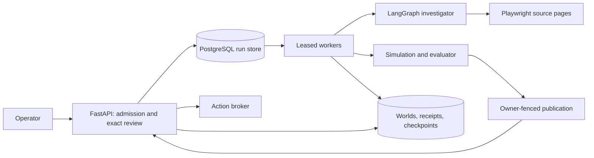

# Deployment

RelayOps runs in two topologies. The public build is a single stateless FastAPI function on Vercel. The durable runtime is an API and separate leased workers over PostgreSQL, packaged for Docker Compose and Kubernetes.

## Public sandbox

`app.py` is the Vercel entrypoint. It forces `RELAY_ALLOW_LIVE=0`, clears provider keys and the database URL, disables the embedded worker, and enables public mode. The app is https://relayops-two.vercel.app.

| Path | Serves |
| --- | --- |
| `/` and `/workspace/*` | Product workspace |
| `/uploads` | Guided import of a visitor's own file |
| `/demo`, `/demo/runs/{id}`, `/demo/architecture`, `/demo/recording` | Interactive four-case sandbox, authority map and recorded walkthrough |
| `/runs`, `/cases`, `/showcase`, `/architecture` | Redirects into the sandbox |

The sandbox exposes `POST /api/demo/investigate`, `/review`, `/execute` and `/reconcile`. Every request rebuilds the selected fixture in a temporary directory and calls the real LangGraph workflow, policy, simulator, executor and evaluator. `/execute` accepts `failure_mode: "acknowledgment_loss"` to commit the first action with an unknown receipt.

Each response carries a sealed envelope. It is an HMAC over the case, stage and proposal version, signed with `RELAY_DEMO_SECRET` (at least 48 characters) and valid for 30 minutes. It is bound to an anonymous HttpOnly, `SameSite=Strict` visitor cookie. Tampered envelopes, envelopes from another browser, changed proposal versions and out-of-order stages are refused. Client-supplied business state is never accepted. History is kept in the visitor's `sessionStorage`, and downloaded reports omit the envelope.

Every response sets a strict content security policy (`default-src 'self'`, `frame-ancestors 'none'`), `Cache-Control: no-store` and `nosniff`. Writes must use same-origin JSON within a bounded body size.

## Durable runtime



`persistence/run_store.py` stores request payloads, idempotency keys and request hashes, owner tokens, lease expiry, terminal status and sanitized error kinds. With `RELAY_DATABASE_URL` set it uses PostgreSQL, and otherwise SQLite. A separate migration creates schema version 1, and `workers/wait_for_database.py` blocks startup until that version exists.

- **Admission.** Admission serializes the idempotency check and the cap of 16 active runs in one transaction.
- **Claiming.** PostgreSQL workers claim with `FOR UPDATE SKIP LOCKED`, and SQLite workers use `BEGIN IMMEDIATE`.
- **Leases.** A worker holds a 60-second lease, renewed every 10 seconds. A heartbeat file updated during polling and renewal backs the container liveness probe.
- **Publication.** A result is published only if the worker still owns the run, the run is still running, and the lease is still valid, all checked under the row lock.
- **Interruption.** Graceful shutdown records interruption. An expired lease is marked interrupted by the next polling worker and is never requeued, so a paid investigation is not replayed.
- **Embedded worker.** `RELAY_EMBEDDED_WORKER=0` disables in-API execution and is required in Compose and Kubernetes. Run `python -m relayops.workers.worker` separately.
- **Operator access.** With `RELAY_ACCESS_TOKEN` set, the API requires that secret as a Bearer token, or as the password of HTTP Basic user `operator`. `/healthz` and `/readyz` stay open, and readiness checks the queue database. A public hostname requires `RELAY_PUBLIC_ORIGIN=https://…`.

## Docker Compose

`backend/docker/Dockerfile` builds `runtime` and `test` targets from Python 3.12 and the hash-locked requirements, including Chromium. The API and worker run as UID 10001. `infrastructure/containers/compose.yaml` runs PostgreSQL 17, migration, API and worker as separate services. Containers drop all capabilities, disallow privilege escalation, use read-only root filesystems with bounded tmpfs and shared memory, and run an init process.

```sh
cp .env.example .env    # set RELAY_POSTGRES_PASSWORD and RELAY_ACCESS_TOKEN
scripts/deployment/compose.sh up --build --wait
curl http://127.0.0.1:8100/readyz
```

`scripts/deployment/compose_smoke.sh` runs a browser-evidence investigation, review and execution against that topology in CI.

## Kubernetes

`infrastructure/kubernetes/base` defines:

- a restricted namespace with tokenless pods;
- migration init containers;
- separate API and worker deployments with resource bounds and probes;
- default-deny network policies with DNS and PostgreSQL egress;
- a ReadWriteOnce state volume.

Secrets come from an externally supplied `relayops-secrets`. The `overlays/kind` overlay adds a test PostgreSQL instance and credentials.

```sh
kubectl kustomize infrastructure/kubernetes/overlays/kind
scripts/deployment/kind_smoke.sh
```

The Kind smoke test works in these steps:

1. Create a disposable cluster, load the image, migrate the database, and scale the workers to zero.
2. Admit a browser-evidence run, restart the API, and assert the run is still queued.
3. Start two workers, then require six browser observations and a passing simulation.
4. Approve the returned version and execute twice, requiring no duplicate effects.

Because worlds, action receipts and checkpoints are SQLite files on the RWO volume, worker pod affinity keeps the API and workers on one node.

## Monitoring

`.github/workflows/public-health.yml` runs `scripts/checks/public_health.py` against the live app at minutes 21 and 51 of every hour, and on demand. The probe uses only the standard library and needs no credentials. It covers:

- the landing script and declared capabilities;
- import of all five file formats, observed SSE stages and exact domain results;
- independent checks, approval with four receipts, and report authenticity;
- rejection of tampered reports, invalid sources and cross-origin requests;
- video byte-range delivery.

Each request has its own deadline under a 90-second total budget, responses are bounded, and nothing is retried. A failure exits nonzero and keeps a seven-day artifact.

[Development](../development/DEVELOPMENT.md) · [Overview](../architecture/OVERVIEW.md)
