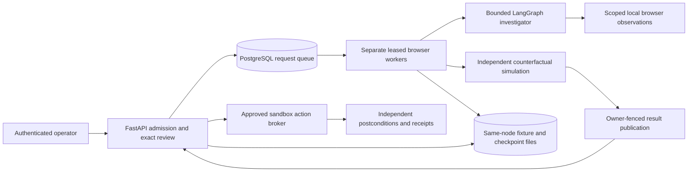

# Durable investigation workers, Docker and Kubernetes

October 14, 2026. This implementation moves investigation execution out of the API process. It establishes a reproducible container/cluster integration boundary; monitored production operation and live model quality remain separate release gates.



## Durable coordination

`backend/src/relayops/persistence/run_store.py` retains request payloads, idempotency keys/hashes, ownership tokens, lease expiry, terminal status and sanitized error kinds. PostgreSQL is selected by `RELAY_DATABASE_URL`; unset keeps an additive SQLite local adapter. A separate migration initializes schema version 1 before API/worker startup.

Admission serializes the queue-cap/idempotency transaction. PostgreSQL workers claim through `FOR UPDATE SKIP LOCKED`; local workers use a SQLite immediate transaction. Workers renew ownership every ten seconds with a sixty-second lease. A process heartbeat updated during polling and lease renewal gives Compose/Kubernetes a meaningful liveness probe; a missing/stale heartbeat or dead process fails it. Result publication checks current owner, running status and lease under the relevant write/row lock before atomically exposing the assessment file. Terminal publication clears ownership.

API startup no longer marks all queued/running investigations interrupted. An API restart therefore retains queued payloads and does not revoke another worker's lease. Graceful worker shutdown records interruption. A missing worker's expired lease becomes interrupted when another worker polls; it is never automatically requeued. Unknown model receipts and partially executed business receipts remain preserved. Recovery must be explicit before a live request is retried.

Existing completed SQLite records and exact reviews are retained. Old active records lacked stored browser configuration and ownership, so the additive migration marks those ambiguous legacy active records interrupted once; it does not guess and replay them. The migration does not import local historical runs into a new PostgreSQL database.

The embedded worker remains the offline default without a database URL. `RELAY_EMBEDDED_WORKER=0` disables API-local execution; this is mandatory in Compose/Kubernetes. `python -m relayops.workers.worker` then claims jobs independently. PostgreSQL mode defaults embedded execution off.

## Access boundary

With `RELAY_ACCESS_TOKEN` configured, the persistent app requires the shared operator secret through HTTP Bearer authentication or HTTP Basic username `operator` and the same secret as password. A browser can use its native Basic authentication prompt. `/healthz` and `/readyz` remain probes; readiness checks the queue database. The configured public hostname requires `RELAY_PUBLIC_ORIGIN=https://...`. Cross-origin mutation, bounded JSON, screenshot hashes, exact assessment/source fingerprints and immutable review continue to apply.

This is one shared operator identity. Individual OIDC users, tenant authorization, roles, approval expiry and revocation are still pending. The Vercel entrypoint remains a public read-only showcase and rejects every mutation; it never runs this durable worker.

## Docker Compose

Python 3.12 and the hashed dependency lock are used locally, in CI and in containers. Runtime and test images include readable Chromium binaries; the API and browser worker run as UID 10001. Compose drops capabilities, disables privilege escalation, provides read-only root filesystems, bounded temporary/shared memory and an init process. PostgreSQL, migration, API and worker are separate services.

```sh
cp .env.example .env
# Privately configure RELAY_POSTGRES_PASSWORD (alphanumeric) and RELAY_ACCESS_TOKEN.
scripts/deployment/compose.sh up --build --wait
curl http://127.0.0.1:8100/readyz
# In the browser use username operator and the privately configured token.
# Open http://127.0.0.1:8100/cases
```

Model generation is explicitly disabled in the checked-in Compose/cluster environments. Enabling concurrent live execution requires a shared financial allowance and controlled evaluation first. Chromium currently visits only authored synthetic evidence pages; hardened worker packaging does not isolate arbitrary hostile browser workloads.

## Kubernetes scope

`infrastructure/kubernetes/base` includes a restricted namespace, tokenless pods, migrated-schema init checks, resource bounds, separate API/worker deployments, API health/readiness probes, default-deny plus DNS/PostgreSQL egress policies, and an RWO state volume. A runtime Secret named `relayops-secrets` is supplied externally. `infrastructure/kubernetes/overlays/kind` supplies test-only PostgreSQL and operator credentials.

The queue is PostgreSQL-backed, but fixture worlds, action receipts and LangGraph checkpoints are still SQLite/POSIX files. Worker affinity deliberately keeps API and workers on the same node with the RWO volume. This is a staging integration topology, not a multi-host/high-availability release. Do not substitute a shared NFS/EFS mount for those SQLite files and claim distributed durability. A production multi-node release requires moving business state/receipts/checkpoints to appropriate database adapters and artifacts to object storage, then testing isolation and recovery.

```sh
kubectl kustomize infrastructure/kubernetes/base
kubectl kustomize infrastructure/kubernetes/overlays/kind
scripts/deployment/kind_smoke.sh
```

The smoke creates a disposable Kind cluster, deploys the actual image, runs migrations, starts API/workers, scales workers down, admits a browser request, restarts the API and asserts the request stayed queued. It then starts two workers, requires six actual browser observations and successful independent simulation, binds review to the returned version, and executes twice while requiring no duplicate sandbox effects. Failure diagnostics and successful synthetic assessments are archived by CI.

Network-policy manifests are rendered and deployed. Kind's default CNI does not establish enforcement of those policies; enforcement needs a policy-capable CNI and dedicated deny/allow tests in staging.

## Evidence and remaining gates

The local PostgreSQL 17.11 suite passes 58 tests with no skips; the separate browser journey passes 16 checks. Four independent store connections exercise concurrent idempotency and claiming; stale ownership cannot publish. A fresh Python worker executes a persisted local request, and API lifecycle tests preserve queued/owned state. No paid model generation occurs in these checks.

CI retains the two existing required jobs and adds the third protected-main requirement `Containers and Kubernetes`, which builds/runs the browser test container, executes the actual Compose browser/review journey, renders both Kustomize targets and executes the complete Kind journey. Actual CI results must be checked before merging.

Remaining production work: individual identity/tenant access; distributed business state/checkpoints/artifacts; isolated execution; a separate enterprise service/action reconciliation boundary; shared live spend control; held-out noisy-document/live evaluations; cloud account/network/TLS wiring; monitored operation; restore/load/security tests; and real user feedback. VerifyOps's unapplied AWS Terraform is a separate project foundation and is not assumed to deploy RelayOps.
