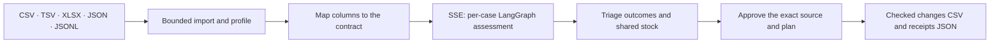

# Product workspace

The product app (`frontend/apps/product/`, served at `/`) applies the RelayOps pipeline to a visitor's own case export. It is built from native ES modules with no framework or build step. `app.js` owns routing and controllers, `state.js` holds unsaved state, `lib/` owns DOM, HTTP, SSE and IndexedDB access, and `views/` renders pages. Source data is always rendered as text nodes, never as HTML.

## Routes

| Route | Page |
| --- | --- |
| `/` | Landing |
| `/workspace` | Overview of deliberately saved work. It starts empty. |
| `/uploads`, `/workspace/new` | Guided intake: source, business rules, review, results |
| `/workspace/history`, `/workspace/investigations/{id}` | Saved investigations with stable detail URLs |
| `/workspace/projects`, `/workspace/projects/{id}` | Project grouping |
| `/workspace/settings`, `/workspace/guide`, `/workspace/login` | Storage, backup, guide and account status |
| `/demo` | Interactive four-case sandbox ([deployment](../operations/DEPLOYMENT.md#public-sandbox)) |

## Assessment flow

Each mapped row becomes a temporary fixture world and runs the real `observe → propose → policy → simulate` graph with `DiagnosticPlanner`. Cases are processed in sorted order-ID order, so shared stock is allocated deterministically. The results show outcomes with semantic badges, shared-stock balances and the independent checks.

`POST /api/uploads/analyze-stream` publishes the actual `running` and `completed` callbacks of each stage. It uses a 32-event mailbox with a separate terminal slot, so a burst of progress events cannot displace the final result or error. A 25-second deadline returns an actionable failure instead of an unending stream.

## Approval and signed reports

Approval is a separate request. It sets an HttpOnly, `SameSite=Strict` visitor cookie and returns an HMAC envelope bound to that visitor, the source and contract hash, and the aggregate plan hash. The envelope expires after 15 minutes and contains no uploaded rows. The follow-up request resends the source. The server re-verifies it, recomputes every plan, then approves and executes against freshly reconstructed temporary worlds. Only independently verified effects reach the exported CSV and JSON receipts.

Completed reports carry a purpose-specific HMAC from `RELAY_REPORT_SIGNING_KEY` (at least 48 characters, falling back to `RELAY_DEMO_SECRET`). Before a saved snapshot is reopened or restored, the browser checks the source fingerprint, the contract and the server's report authentication. A modified or re-signed report returns to review and does not show as verified. Rotating the key invalidates older receipts by design.

## Device storage

Nothing is saved without consent. A consented save writes an immutable IndexedDB snapshot of the normalized source, the rules and the report. Every edited rerun creates a new snapshot ID, and earlier results are kept. Transactions enforce a limit of 20 projects and 50 snapshots per device. Settings exports a portable JSON backup. Restoring it needs fresh consent, reparses every source, and rechecks every report before one atomic import under new IDs.

## Optional cloud accounts

Accounts are off unless `RELAY_SUPABASE_URL` (HTTPS) and a publishable `RELAY_SUPABASE_PUBLISHABLE_KEY` are configured. Service and admin keys are refused. Identity is validated server-side with the provider and carried in HttpOnly cookies. PostgREST receives the user's own token, never an admin credential. `RELAY_ACCOUNT_SIGNUP=1` enables self-registration.

The [migration](../../infrastructure/supabase/migrations/001_product_workspace.sql) creates owner-isolated, immutable project and investigation tables with forced row-level security, owner-scoped foreign keys and serialized per-owner quotas. `scripts/checks/product_rls.py` applies it to a disposable PostgreSQL database in CI. It exercises two owners, denial of anonymous, spoofed and update access, and concurrent quota enforcement, then drops the database.

## Tests

| Suite | Coverage |
| --- | --- |
| `scripts/demos/product_browser.py` | Real file upload, reviewed rules, approval with four checked receipts, exports, device save and reload, tamper refusal, rerun snapshots, backup restore, network retry, keyboard tabs and dialogs, 320–1440 px layouts, and 14 axe views |
| `scripts/demos/import_browser.py` | All five formats through file selection to checked results, worksheet choice and cancellation, invalid-file recovery |
| `backend/tests/api/test_product.py` | Provider-verified identity, consent, owner-scoped access, redacted errors |
| `backend/tests/api/test_product_evidence.py` | SSE terminal behavior, nested-report tampering, key rotation, cell-precise errors |

[Data imports](DATA-IMPORTS.md)
