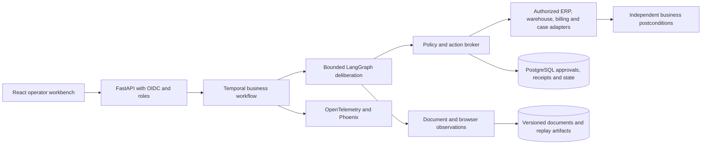

> Historical record. [Current project overview](../../../README.md) and [current handoff](../HANDOFF.md) take precedence.

# Architecture

October 14 current implementation: [durable worker and Kubernetes foundation](../../operations/DURABLE-WORKERS.md) adds PostgreSQL investigation coordination, a separate leased browser worker, restart preservation, shared-operator access, hardened Python 3.12 Docker/Compose and a restricted same-node Kind topology. Earlier API-local/no-container/no-queue statements are historical. Business state/checkpoint/object migration and monitored cloud operation remain open.

October12 current implementation: [model-directed agent and local workbench](../../architecture/AGENT-WORKBENCH.md) add persistent dynamic tool selection, real browser/document screenshots, cited public hypotheses, bounded correction, actual SDK HTTP/SSE checks and operator pages. Earlier no-browser/no-server/single-call-only statements below describe the initial foundation and are superseded for current coverage; live quality, arbitrary UI actions, scanned-document extraction and distributed/cloud release remain pending.

## Implemented foundation

Python3.11.17; strict Pydantic frozen Plan/Action; LangGraph observe→propose→policy→simulate; original SQLite fixture world with evidence/approval/receipt/event tables; controlled executor; separate final-state evaluator; diagnostic and gated AsyncAnthropic planners. Graph state is ephemeral, not checkpointed. One ledger per fixture/run; no distributed queue or individual authentication.

## Proposed release

Temporal should own business timers, approvals and recovery; LangGraph should own bounded model deliberation. Model/connector calls become explicit activities. Side-effect identity/approval/postconditions stay in the broker; replay must not duplicate them. Add these systems through measured integration gates, not a framework-count target.

Browser sessions must be isolated and restrict origins/downloads/network. Client DOM attributes cannot grant write authority. Trusted adapters authorize semantic writes against the exact plan and resource versions. Prefer APIs when available; use browser interactions for supported legacy flows and controlled benchmarking. React/FastAPI/Temporal/PostgreSQL/OS isolation are not yet implemented.
