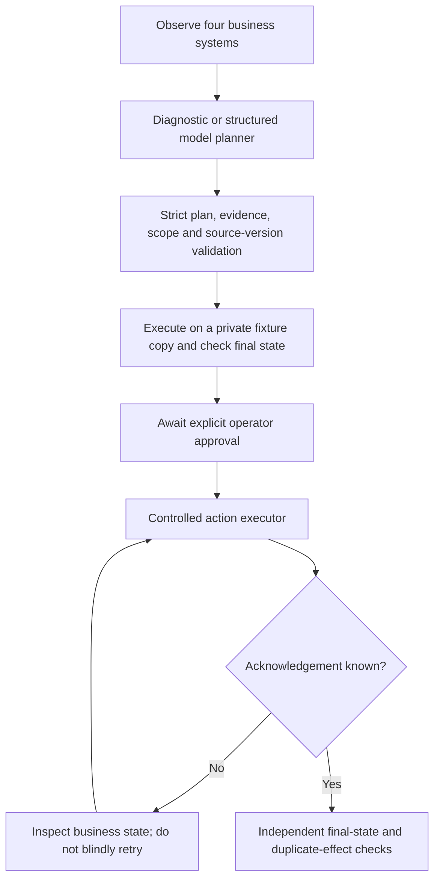

> Historical record. [Current project overview](../../../README.md) and [current handoff](../HANDOFF.md) take precedence.

> Foundation README preserved October12,2026. Statements below describe the initial26-test milestone and are superseded by the current README.

# RelayOps

**An enterprise workflow agent that investigates exceptions, proposes business actions, and verifies what actually happened.**

Second agentic AI flagship. Initial business lane: resolve a short shipment across procurement, warehouse, billing and case management. Target capabilities include multimodal document/browser observations, policy-constrained planning, durable execution, uncertain-outcome recovery and cloud deployment.

**Current: executable local foundation.** Original structured synthetic fixtures, strict plans, a LangGraph assessment workflow, independent final-state checks, explicit sandbox approval, action receipts/reconciliation, and a gated official Anthropic single-request planner. No live model run, browser agent, production connector, customer validation or deployment yet. GitHub repository: TBD.

## Business workflow

Order100units at$25each; confirmed delivery80; invoice100. Establish the20-unit shortage, hold$500, open a20-unit supplier claim, reserve20replacement units and resolve the case only after effects are confirmed. Missing/inconsistent evidence or insufficient stock requires clarification without writes.



The first graph produces an assessment and never approves writes to the original world. Counterfactual simulation uses a separate temporary fixture. CLI sandbox execution requires an explicit flag; its approval label is a synthetic demonstration, not customer review.

## Run the foundation

Python3.11:

```sh
python3.11 -m venv .venv
.venv/bin/python -m pip install --require-hashes -r backend/requirements.txt
PYTHONPATH=backend/src .venv/bin/python -m relayops --output artifacts/generated/assessment-001
PYTHONPATH=backend/src .venv/bin/python -m relayops --output artifacts/generated/execute-001 --execute-sandbox --inject-ack-loss
PYTHONPATH=backend/src .venv/bin/python -m relayops --output artifacts/generated/clarify-001 --unknown-delivery
PYTHONPATH=backend/src .venv/bin/python -m unittest discover -s backend/tests -v
```

Use a fresh output directory. Inspect report.json and the local fixture journal. The injected acknowledgement loss applies a hold, marks the receipt unknown, reconciles it, and resumes without a duplicate effect. Source updates invalidate the approved proposal and require fresh review; partially applied work is retained.

The provider planner is explicitly gated by exported ANTHROPIC_API_KEY, RELAY_MODEL matching data/pricing.json and RELAY_ALLOW_LIVE=1. It does not load another project's private configuration. It permits one planning generation per fixture ledger, performs active-model/token/estimate admission, disables generation retries and retains uncertain receipts. It has an8000-input/2048-output token bound,60second active deadline and$0.25estimated single-request allowance; this is not a provider invoice cap. Do not enable live mode without reviewing the scope and funding.

## Current evidence

26known development checks initially pass; final rerun/results are in [progress](../PROGRESS.md). They cover approval/scope/evidence/version boundaries, wrong amounts/order, no blind retry after acknowledgement loss, fresh-process reconciliation, concurrent duplicate prevention, false final-state rejection, abstention/healthy controls, varied integer currency and scripted model admission/invalid-response behavior. Scripted SDK objects do not establish live model quality or actual provider transport compatibility.

SQLite is only the local single-host fixture/receipt implementation; external services are not atomically coordinated. Graph checkpoints, PostgreSQL, Temporal, browser grounding and full provider-HTTP evaluation remain pending.

## Build direction and documentation

- [Project brief](../../product/BRIEF.md) · [Architecture](../../architecture/OVERVIEW.md) · [Flow](../../architecture/FLOW.md)
- [Data](../../architecture/DATA.md) · [AI design](../../architecture/AI-DESIGN.md) · [Evaluation](../../evaluation/README.md)
- [Setup and deployment](../../operations/DEVELOPMENT.md) · [Demo/evidence](PORTFOLIO-PLAN.md)
- [Decisions](../../DECISIONS.md) · [References](../../REFERENCES.md) · [Plan](../PLAN.md) · [Handoff](../HANDOFF.md)

Intended release stack: LangGraph deliberation, Temporal business lifecycle, PostgreSQL, controlled Playwright sessions, FastAPI, React/Next.js/TypeScript, object storage and OTel/Phoenix. These components are proposed beyond the implemented kernel.
