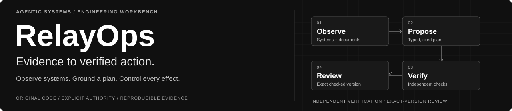
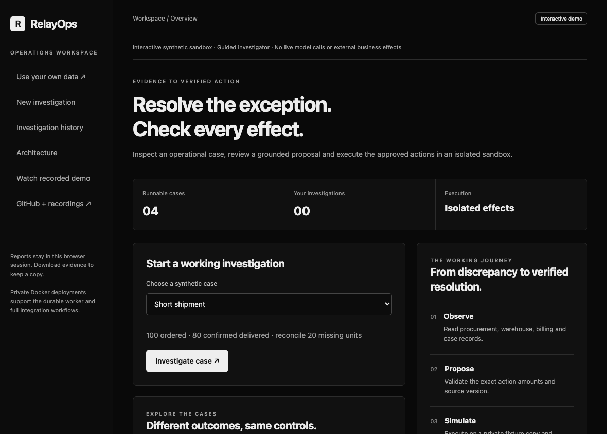
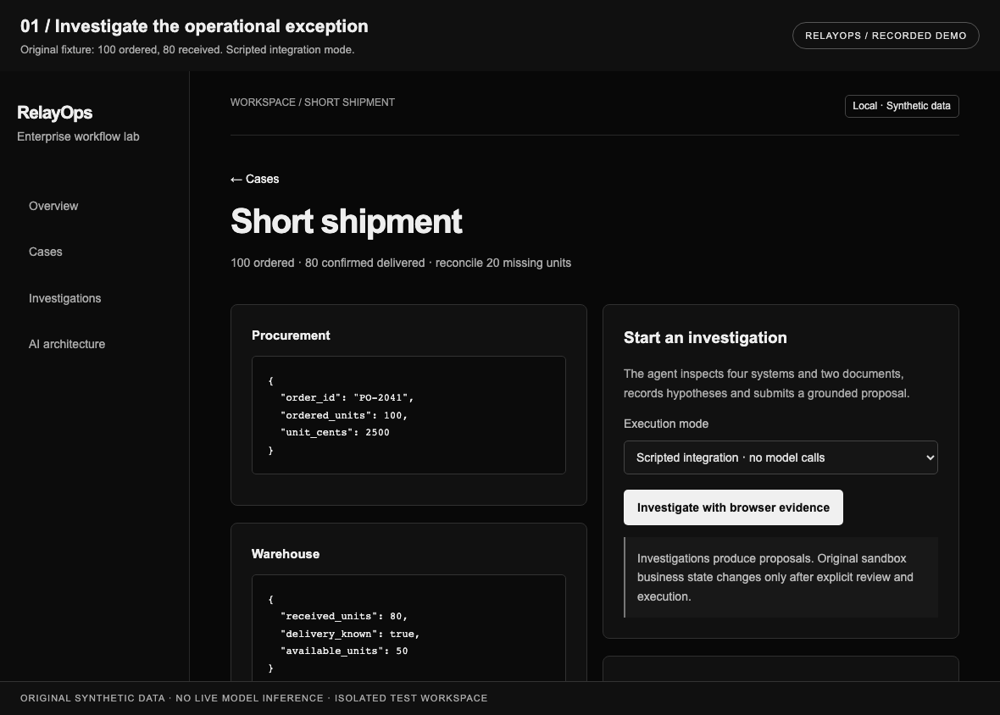
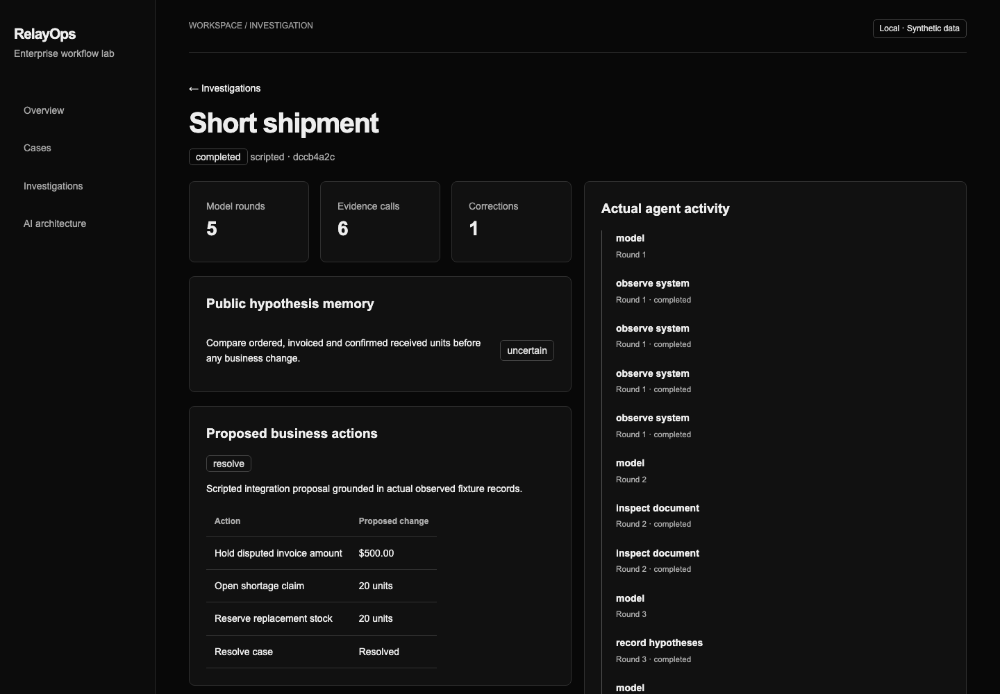
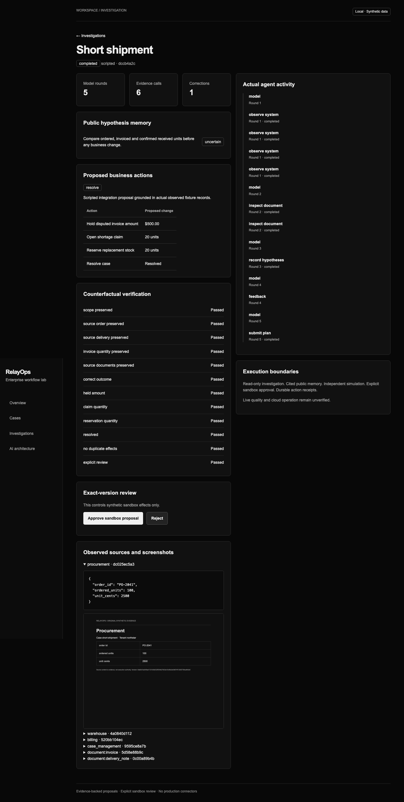
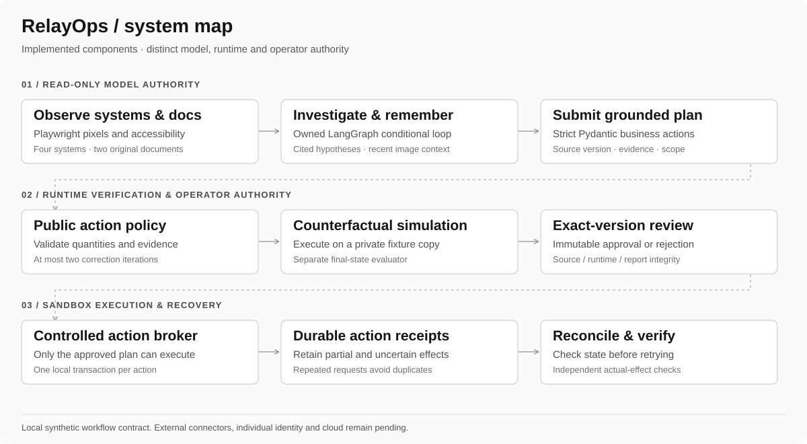
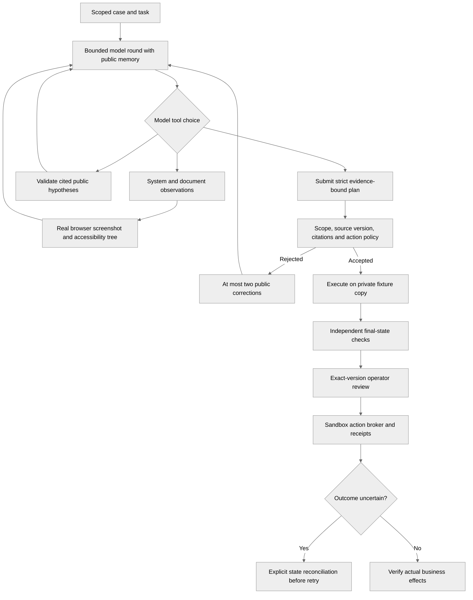
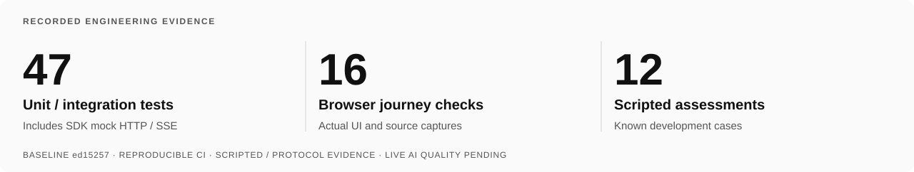

> Historical record. [Current project overview](../../../README.md) and [current handoff](../HANDOFF.md) take precedence.

<p align="center">
  
</p>

<p align="center">
  <a href="https://github.com/Akhilesh-Vangala/relayops/actions/workflows/checks.yml"></a>
  &nbsp; Python 3.12 · LangGraph · PostgreSQL · Playwright · Kubernetes
</p>

<p align="center">
  <a href="docs/CASE-STUDY.md">Case study</a> ·
  <a href="https://relayops-two.vercel.app">Working app</a> ·
  <a href="docs/DEMO.md">Recorded demo</a> ·
  <a href="#inside-the-agent">Agent architecture</a> ·
  <a href="#the-operator-workbench">Workbench</a> ·
  <a href="#run-locally">Quick start</a> ·
  <a href="#engineering-evidence">Evidence</a> ·
  <a href="docs/README.md">Technical documentation</a>
</p>

# RelayOps

**A workflow agent that observes business systems, grounds a proposal in evidence, and executes only an explicitly approved version.**

RelayOps investigates procurement, warehouse, billing and case evidence through a checkpointed LangGraph tool loop. Proposals pass separate simulation and business-state checks, then exact-version sandbox review before controlled execution.

> **Development release.** The [public Vercel app](https://relayops-two.vercel.app/demo) runs an interactive guided sandbox with actual verification. [Watch the continuous recording](https://relayops-two.vercel.app/demo/recording). Default demos are scripted and synthetic. Live model quality, scanned-document extraction, production connectors, individual identity and durable cloud workflow execution remain pending. [Durable worker/container foundation →](../../operations/DURABLE-WORKERS.md)

| Run the product | Inspect the engineering | Challenge the evidence |
| --- | --- | --- |
| [Interactive app](https://relayops-two.vercel.app) · [Quick start](#run-locally) · [Recorded walkthrough](../../DEMO.md) | [Design case study](../../architecture/CASE-STUDY.md) · [System map](../../README.md) | [Reproducible checks](../../../.github/CONTRIBUTING.md) · [Limits and tradeoffs](../../architecture/CASE-STUDY.md#what-the-evidence-establishes) |

## Try it and watch it

[**Open the interactive app →**](https://relayops-two.vercel.app/demo) · [**Watch the continuous recording →**](https://relayops-two.vercel.app/demo/recording) · [Recording file](../../../frontend/apps/demo/assets/media/walkthrough.webm)



Choose a shortage → inspect the real LangGraph diagnostic and private-copy simulation → approve the checked proposal → execute sandbox actions → reconcile a deliberately lost acknowledgment → independently verify final state. Four confirmed action receipts and a repeated execution check are visible.

**Actual calculations, guided synthetic data, no model charges.** Browser-local history and signed version checks support the public flow. Persistent private workers and live-model evaluations are separate. [Public architecture and limits](../../operations/PUBLIC-SANDBOX.md) · [Recording provenance](../../demos/history/2026-10-14-interactive-recording.json) · [Verified public execution](../../evaluation/PUBLIC-DEMO-EVIDENCE.md).

## The private operator workbench

<picture>
  <source media="(prefers-reduced-motion: reduce)" srcset="../../assets/demos/relayops-demo-poster.png">
  
</picture>

**14-second recorded walkthrough.** Actual app execution with original synthetic data and scripted model choices. The review is an automated sandbox demonstration; no production financial effects or live model inference. [Static frames and recording provenance →](../../DEMO.md)

The app has overview, case catalog, case detail, investigation history, investigation detail and architecture pages. Open a case, run an investigation, inspect source screenshots and cited hypotheses, review the proposal, then explicitly execute approved sandbox actions. Activity and outcomes come from stored records.

<details>
<summary><strong>Inspect the real investigation screen and source evidence</strong></summary>





These captures use original synthetic data and scripted model choices. The shown proposal has not been approved; screenshots do not establish live AI accuracy or customer usage.

</details>

## The business problem

<picture>
  <source media="(prefers-color-scheme: dark)" srcset="../../assets/branding/relayops-case-dark.svg">
  
</picture>

A supplier invoices **100 units at $25 each**, but the warehouse confirms receipt of **80 units**. Paying the entire invoice or retrying an uncertain action can create an incorrect business outcome. Resolving the exception requires consistent evidence from several systems and verified effects after review.

| Source-backed finding | Proposed action under the supported contract |
| --- | --- |
| Confirmed 20-unit shortage; consistent order and invoice; sufficient stock | Hold **$500**, create a **20-unit** supplier claim, reserve **20 replacement units**, then resolve the case. |
| Unknown delivery, conflicting invoice quantity or insufficient stock | Request clarification and produce **no business actions**. |
| Complete, consistent delivery | Return **no change**. |

This is an original synthetic workflow with a declared action contract. It supports reviewable engineering experiments; additional business lanes require new contracts and validation environments.

## Engineering contribution

The owned work connects **model-directed observation**, **cited public hypotheses**, **private-copy simulation**, **exact-version review**, and **receipted sandbox actions**. Application code preserves source/runtime compatibility, uncertain generations, partial effects and explicit reconciliation. The supported workflow is a declared contract. [Design decisions, failure cases and implementation entry points →](../../architecture/CASE-STUDY.md)

## Inside the agent



The model chooses `observe_system`, `inspect_document`, `record_hypotheses` and `submit_plan`. It cannot approve or execute its own proposal. **relay-agent-1** uses actual conditional graph transitions, durable investigation checkpoints and model-result receipts. Public policy feedback permits at most two corrections; private evaluator answers do not enter the feedback loop.

<details>
<summary><strong>Expand the detailed agent flow and implemented layers</strong></summary>



| Layer | Actual behavior |
| --- | --- |
| **Model-directed tool use** | Agent chooses `observe_system`, `inspect_document`, `record_hypotheses` or `submit_plan`. No fixed collection sequence in the live controller. |
| **Multimodal observations** | Playwright captures original local pages, screenshots and accessibility trees; image content is passed to the model. This is not yet real scanned-document extraction or general GUI navigation. |
| **Grounded public memory** | Hypotheses cite observed evidence; current interpretations and recent evidence IDs are included in model context. No hidden chain-of-thought is requested or displayed. |
| **Context management** | Only the latest two images stay in model context; original PNGs/hashes and textual observations remain stored. Byte/token bounds apply before generation. |
| **Critique and correction** | Strict schema, evidence coverage, source and business-policy feedback permit two corrections; private evaluator answers never enter feedback. |
| **Persistent investigation** | SQLite LangGraph checkpoints plus model-result receipts; recovery requires identical source/runtime/client/pricing/browser configuration. Uncertain generations block replay. |
| **Independent checking** | Private-copy simulation, separate final-state evaluator and unchanged-source/duplicate-effect checks. These are scoped checks, not universal proof. |
| **Review and action control** | Immutable exact-version sandbox review; stale/tampered/source-changed assessments blocked. Controlled actions retain receipts, uncertain outcomes and partial state. |
| **Operator visibility** | Home, cases, investigation history/detail, evidence screenshots, hypothesis memory, real activity, proposed changes, verification and architecture pages. |

</details>

| Engineering boundary | Current behavior |
| --- | --- |
| **Source grounding** | Four system observations and two document observations; cited evidence, source-version checks and hashed real screenshots. |
| **Multimodal context** | Browser pixels and accessibility text enter model tool results. Only the latest two images remain in context; original image artifacts stay retained. |
| **Verification** | Public action policy, private-copy simulation and a separate final-state evaluator. Execution is followed by independent actual-effect checks. |
| **Approval integrity** | Immutable exact-version sandbox review; changed source, runtime, report or artifacts block stale approval. |
| **Recovery** | Completed model receipts avoid a second generation; uncertain generations block replay. Action receipts retain partial effects and require explicit reconciliation before retry. |
| **Model bounds** | 12 rounds, 24 evidence calls, 3 identical calls, 2 corrections; 8,000 input tokens per request / 64,000 cumulative; 2,048 requested output per round / 12,000 total; 240 active model seconds; 2 MB request body. |
| **Estimated spending** | $0.50 cumulative commitment allowance per run; unknown usage retains reservations. Reported overruns are accounted for before another generation. This is not a provider invoice cap or shared billing service. |

PostgreSQL coordinates separate leased workers in container mode. Fixture/action/checkpoint files and browser contexts remain within a same-node development boundary. Multi-host business state, external connectors and OS-level execution isolation require additional implementation.

[Implementation and boundaries](../../architecture/AGENT-WORKBENCH.md) · [Source map and tradeoffs](../../development/REPOSITORY.md) · [Decisions](../../DECISIONS.md)

## Docker and Kubernetes

The persistent runtime uses PostgreSQL admission and separate leased browser workers. Docker Compose runs migration/API/worker/PostgreSQL; Kubernetes uses a restricted namespace and an explicit same-node storage boundary for remaining fixture/checkpoint files. [Full topology, commands and limits](../../operations/DURABLE-WORKERS.md).

```sh
cp .env.example .env
# Configure private operator and PostgreSQL values.
docker compose up --build --wait
```

## Run locally

Use Python **3.12** locally, in CI and in the container. From a fresh checkout:

```sh
git clone https://github.com/Akhilesh-Vangala/relayops.git
cd relayops
python3.12 -m venv .venv
.venv/bin/python -m pip install --require-hashes -r backend/requirements.txt
.venv/bin/python -m playwright install chromium
PYTHONPATH=backend/src RELAY_ALLOW_LIVE=0 .venv/bin/python -m relayops.web --port 8100
```

Open **http://127.0.0.1:8100**. The default scripted integration demonstrates actual evidence collection, a rejected proposal, correction, independent simulation and explicit sandbox review. No API key is needed. The server binds to loopback; persistent local data is stored under `artifacts/generated/app`.

<details>
<summary><strong>Run the CLI, checks and known development matrix</strong></summary>

```sh
PYTHONPATH=backend/src RELAY_ALLOW_LIVE=0 .venv/bin/python -m unittest discover -s backend/tests -v
PYTHONPATH=backend/src RELAY_ALLOW_LIVE=0 .venv/bin/python tests/e2e/browser_workbench.py
PYTHONPATH=backend/src RELAY_ALLOW_LIVE=0 .venv/bin/python -m relayops.agent_cli --output artifacts/generated/browser-demo --browser --test-correction
PYTHONPATH=backend/src RELAY_ALLOW_LIVE=0 .venv/bin/python -m relayops.benchmark --output artifacts/generated/development-matrix
```

Use fresh output directories. `agent_cli --recover` explicitly resumes a compatible saved investigation. The legacy `python -m relayops` CLI retains the foundation assessment and acknowledgement-loss sandbox examples.

</details>

<details>
<summary><strong>Enable a bounded live model run privately</strong></summary>

Configure exported `ANTHROPIC_API_KEY`, `RELAY_ALLOW_LIVE=1` and `RELAY_MODEL` matching the trusted pricing profile. Then select the live workbench mode or `agent_cli --client anthropic`. The project uses the official async SDK and typed streaming; generation retries are disabled. It never imports another project's private configuration.

Live runs are billable and must pass model, token and estimated-spend admission. No live generation has been performed in the recorded evidence below. [Configuration and limits](../../architecture/AGENT-WORKBENCH.md).

</details>

## Engineering evidence

<picture>
  <source media="(prefers-color-scheme: dark)" srcset="../../assets/branding/relayops-evidence-dark.svg">
  
</picture>

The recorded local checks below belong to implementation baseline [`dc85c15`](https://github.com/Akhilesh-Vangala/relayops/commit/dc85c1536d9cb95054bfd26542d9b46ed2e8c2ef). The publication baseline at [`7aa02f7`](https://github.com/Akhilesh-Vangala/relayops/commit/7aa02f7c74cca3c1826f612e83b378a957fd1751) passed both Linux jobs in [Actions run 38345763992](https://github.com/Akhilesh-Vangala/relayops/actions/runs/38345763992). Logs and downloaded artifacts confirm the same counts. The badge tracks the current branch.

| Check | Verified result | What it tests |
| --- | --- | --- |
| Unit and integration suite | **47 passed** | SDK HTTP/SSE assembly over mocked transport, checkpoint recovery, strict citations, receipt reuse, review integrity and duplicate prevention. |
| Actual browser journey | **16 checks passed** | Six source captures, proposal correction, review/execution, grounded clarification, five pages across four viewport widths, no runtime errors. |
| Known scripted development matrix | **12/12 assessments passed** | Original short-shipment variants, missing evidence, conflicting quantities, stock boundaries and no-change cases. |
| Fresh-process / concurrency tests | Included in the unit suite | Explicit uncertain-action reconciliation in a new Python process and concurrent duplicate-effect prevention. |

These counts are **engineering and integration evidence**, not live model accuracy, held-out performance or customer validation. The CI badge links to current-branch Linux checks. Actions uploads browser evidence and matrix reports; generated runtime stores and logs stay out of Git.

## Repository map

```text
relayops/
├── backend/src/relayops/        Agent, browser tools, policy, action broker, API and UI
├── tests/              Protocol, recovery, execution and browser journeys
├── docs/               Architecture, AI design, evaluation, setup and original visuals
├── .github/            Reproducible checks and review templates
├── backend/requirements.txt    Fully pinned dependency hashes
├── PLAN.md             Implementation and release gates
└── CONTRIBUTING.md     Local verification and evidence conventions
```

[Technical documentation](../../README.md) · [Publication evidence](GITHUB-PUBLICATION.md) · [Code and design tradeoffs](../../development/REPOSITORY.md) · [Research references](../../REFERENCES.md) · [Progress](../PROGRESS.md) · [Handoff](../HANDOFF.md)

## Next release gates

Controlled live model comparisons; noisy document extraction with field provenance; new frozen workflow/layout tasks and safety evaluations; external action adapters; PostgreSQL/Temporal and individual identity; isolated execution and monitored cloud delivery; actual user feedback. [Full implementation plan](../PLAN.md).

[Branch and release workflow](../../development/BRANCHING.md) · [Contributing](../../../.github/CONTRIBUTING.md)
